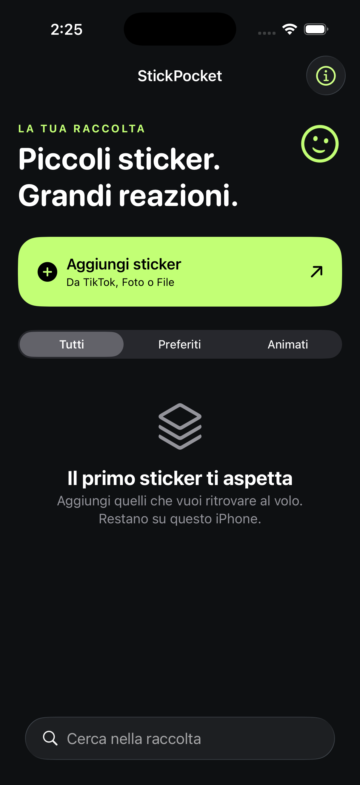

# StickPocket per iPhone

Progetto nativo SwiftUI per Luigi, indipendente da Replit. Nome provvisorio: StickPocket.

**Stato: prima versione di sviluppo, compilata con Xcode 26.6 in configurazione
Release per iPhone. L’archivio prodotto è senza firma: non è installabile e non
è su TestFlight. Il recupero da TikTok non è stato verificato su un account
reale o su iPhone. Per i test eseguiti vedere VALIDATION.md.**

Schermata reale della versione avviata sul simulatore iPhone 17 Pro:

## Cosa contiene

- Raccolta locale con ricerca, preferiti, rinomina ed eliminazione.
- Importazione da Foto e File; nessuna richiesta di accesso all’intera galleria.
- Conservazione dei file originali, inclusi GIF e WebP, senza convertirli in PNG.
- Riconoscimento dei file identici e anteprime leggere per la raccolta.
- Visualizzazione degli originali animati attraverso il motore web di iOS.
- Ritaglio delle immagini ferme in una nuova copia PNG, con orientamento corretto.
- Condivisione tramite il pannello di iPhone e salvataggio facoltativo in Foto.
- Due ingressi per TikTok: video/commenti e messaggi personali.
- Ricerca delle immagini rese visibili nella pagina aperta, scelta manuale,
  anteprima dell’originale e salvataggio.
- Icona, progetto Xcode, test, configurazione di verifica GitHub Actions.

## Come viene recuperato uno sticker da TikTok

L’utente apre TikTok dentro l’app, accede direttamente sul sito se necessario,
apre un video o una propria chat e porta lo sticker sullo schermo. Premendo
“Scegli immagini visibili” l’app legge gli indirizzi delle immagini caricate e ne
mostra una selezione. La selezione può includere immagini che non sono sticker.

Il download usa soltanto l’indirizzo originale di un’immagine scelta dall’utente.
Non usa API non documentate, non legge testi delle chat o credenziali, non
esporta cookie e non prova ad aggirare limitazioni del sito. Gli originali
protetti da autenticazione aggiuntiva, le immagini blob e le immagini rese con
canvas o sfondi CSS non sono recuperate da questo primo metodo.

TikTok può non consentire login, commenti o messaggi dentro una vista web. La
disponibilità di questo percorso deve essere verificata con iPhone e account
reali. Non è garantito il download di ogni sticker, né il recupero automatico di
tutti gli sticker di una chat.

Se il recupero dell’originale fallisce, l’utente può importare un file già salvato
oppure uno screenshot e ritagliarlo. Uno screenshot non conserva l’animazione.

## Apertura e prove

Requisiti: Xcode 26 o successivo, SDK iOS e simulatore iPhone; destinazione minima
iOS 17. Nessun pacchetto Swift esterno, nessuna chiave API e nessun server.

1. Aprire StickPocket.xcodeproj.
2. Selezionare lo schema StickPocket e un simulatore iPhone.
3. Eseguire Build e poi Test.
4. Provare importazione, riapertura dell’app, animazioni, condivisione e ritaglio.
5. Su iPhone reale scegliere il proprio Team in Signing & Capabilities e
   configurare un identificatore app disponibile. Quello nel progetto è
   com.luigi.stickpocket: non è stato registrato su Apple.

La verifica completa può essere eseguita su un Mac con:

    bash scripts/test-ios.sh

Lo script richiede Node per i test del selettore web e Xcode per i test nativi.
Il progetto e il workflow .github/workflows/ios-check.yml sono caricati in
https://github.com/th1sable/stickpocket-ios .
Il repository è pubblico per usare i runner standard gratuiti di GitHub.
Il workflow si attiva solo manualmente. La prima esecuzione è stata avviata il
21 ottobre 2026; l’esito verificato è riportato in VALIDATION.md.
Quando i test riescono, il workflow avvia anche l’app sul simulatore e conserva
una schermata nell’artefatto test-ios, insieme al risultato dei test.

Il workflow manuale `Build iPhone con Xcode 26` esegue anche:

    bash scripts/archive-ios.sh

Questa verifica genera un archivio Release per iPhone senza firma, scaricabile
dagli artefatti GitHub per 7 giorni. Non è un IPA installabile: per distribuirlo
servono la configurazione Apple e una nuova build firmata. Il codice sorgente
rimane nel repository dopo la scadenza degli artefatti.

Per rigenerare il progetto dopo aver aggiunto o rimosso file Swift:

    python3 scripts/generate-project.py

## Passaggio a TestFlight

Il progetto non contiene certificati, profili o credenziali Apple. Prima della
distribuzione servono:

1. Una compilazione riuscita su macOS e il superamento dei test nativi.
2. Prove reali dei flussi TikTok e dei formati animati su iPhone.
3. Team Apple, identificatore app, firma e scheda App Store Connect configurati.
4. Archivio firmato e caricamento su TestFlight.
5. Revisione finale delle informazioni privacy e delle descrizioni pubbliche.

Nessuna app è stata inviata ad Apple e nessun servizio a pagamento è stato
attivato per questo progetto.

## Dati e limiti della prima versione

La raccolta è in Application Support, protetta dal blocco del dispositivo ed
esclusa dal backup iCloud. Non è sincronizzata tra dispositivi. La disinstallazione
elimina la raccolta; esportare in File o Foto gli originali da conservare.

Il browser TikTok ha una sessione temporanea. La raccolta non salva indirizzi
firmati delle immagini, nomi delle chat o testi dei messaggi. Il codice
dell’app non contiene statistiche, pubblicità o backend. TikTok e i provider di
login scelti dall’utente gestiscono le proprie connessioni e i propri dati.

Il download degli originali ammette solo HTTPS e un insieme esplicito di domini
TikTok/CDN. I reindirizzamenti sono controllati. Un nuovo dominio legittimo dovrà
essere aggiunto solo dopo verifica: un dominio non riconosciuto produce un
errore, non un tentativo su qualsiasi indirizzo.

Limiti intenzionali: 25 MB per file, 32 milioni di pixel, fino a 20 importazioni
per selezione da Foto/File, fino a 48 immagini nella selezione web. Solo immagini
visibili di almeno 24 pixel, con esclusione euristica degli avatar. Lo scorrimento
della chat resta manuale.

Le modifiche non appiattiscono le animazioni: il ritaglio è disponibile soltanto
per immagini ferme. WebP animati conservati byte per byte; la capacità di
anteprima va verificata sul sistema iOS di destinazione. Nessuna conversione
automatica in pacchetti WhatsApp, nessuna estensione tastiera iMessage, nessuna
conversione di registrazioni schermo in GIF in questa versione.

Vedere VALIDATION.md per i controlli realmente eseguiti.

## Riferimenti usati per l’implementazione

- Apple WKWebView:
  https://developer.apple.com/documentation/webkit/wkwebview/
- Apple Photos picker:
  https://developer.apple.com/documentation/photokit/bringing-photos-picker-to-your-swiftui-app
- Apple ImageIO:
  https://developer.apple.com/documentation/imageio/cgimagesourcecreatethumbnailatindex(_:_:_:)
- TikTok, tipi di dati esportabili:
  https://developers.tiktok.com/doc/data-portability-data-types
- TikTok, commenti Research API:
  https://developers.tiktok.com/docs/en/research-api-specs-query-video-comments
- GitHub, test Swift e runner:
  https://docs.github.com/en/actions/tutorials/build-and-test-code/swift

Queste fonti descrivono le API, non dimostrano che l’integrazione TikTok di questo
progetto funzioni. Tale verifica resta necessaria su dispositivo.
